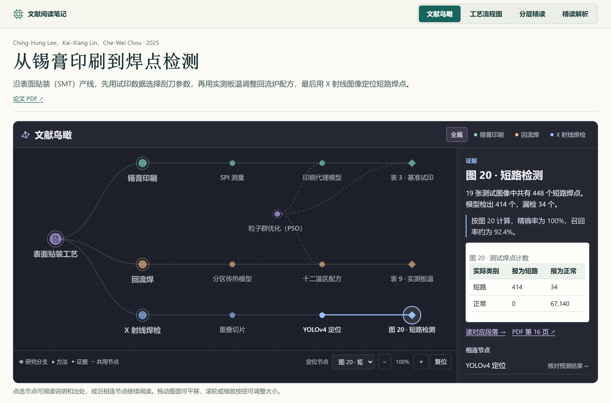
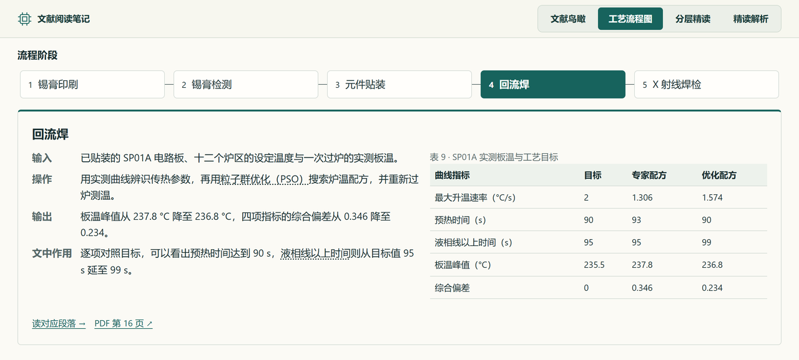
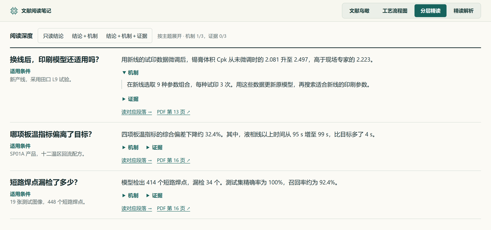
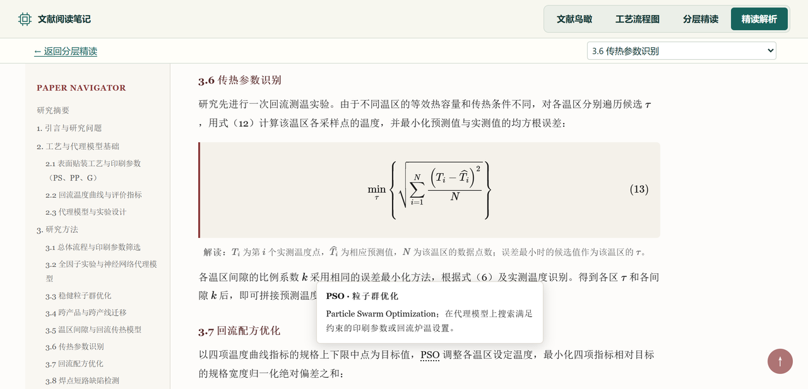

# MD2 Research

MD2 Research 是一个用于读论文和做组会汇报的 Codex 插件。给它一篇 PDF，可以生成带原图、数据表和公式的 HTML 阅读笔记，也可以继续整理成中文 PPTX。阅读时，从图谱里的一个结果点进正文，就能核对它来自哪次实验、哪张表，再回到刚才选中的节点。



这组截图来自一篇 SMT 产线研究。沿鸟瞰图的焊点检测分支点到图 20，可以看到测试集中 448 个短路焊点有 414 个被检出、34 个被漏检。想核对数字，点“读对应段落”就能查看混淆矩阵和指标解读。[示例论文（Lee、Lin、Chou，2025）](https://doi.org/10.1007/s00170-025-15032-w)

## 快速开始

在 Codex 中安装插件：

```sh
codex plugin marketplace add white-drizzle/md2-research-plugin
codex plugin add md2-research@md2-research
```

在聊天中选中 **MD2 Research**，附上论文 PDF，就可以这样提要求：

- **读一篇新论文**　“把这篇论文做成 HTMLnote。我想先了解研究框架，再按分支读方法和证据。”
- **逐段读原文**　“做成中英对照精读。保留英文原文、公式编号和图注，解释关键术语。”
- **准备组会**　“把这篇论文做成中文汇报 PPT，听众没读过原文，请用图表讲清实验和结论。”

## 一份笔记，四个阅读入口

| 想弄清什么 | 从哪里进入 |
|---|---|
| 作者研究了哪些问题，方法之间有什么关系？ | **文献鸟瞰**。点选研究分支、共用方法或实验证据，查看说明和出处。 |
| 每一步用了什么输入，又得到什么输出？ | **工艺流程图**。沿工位或方法步骤选读。计算、理论和综述论文可以用研究流程或论证路径。 |
| 这条结论在什么条件下成立？ | **分层精读**。先看结论与适用范围，再展开机制和实验证据。各主题可独立展开。 |
| 这个数字出自哪张表，公式是怎样推出来的？ | **精读解析**。图表紧随对应解释段落，术语可悬停、聚焦或点按查看释义。双语模式还可切换原文、译文和解读。 |

| 沿流程选读 | 按深度展开 |
|---|---|
| [](assets/readme/flow.webp) | [](assets/readme/depth.webp) |

例如，要判断换线后是否值得微调模型，需要把**同一条新产线**上的三组结果放在一起看。示例论文表 4 用锡膏体积的过程能力指数（Cpk）衡量印刷质量。三个实测均值为 2.081（直接沿用）、2.223（专家设置）和 2.497（微调后）。分层精读先给出这组发现，再让读者展开实验条件或追到表 4。读到回流传热模型时，切入精读解析可以查看时间常数的拟合公式，悬停在 PSO 上可以查阅术语释义。

<details>
<summary>展开精读解析截图</summary>



</details>

四个入口都在同一份 HTML 中。导读中的证据链接会打开精读解析里的对应章节、图或表。返回导读时，可继续使用原先的节点、工位或展开状态。提供本地 PDF 时，还可以按页核对原文。

## 三个技能如何配合

| 技能 | 交付物 |
|---|---|
| [pdf2md](skills/pdf2md/SKILL.md) | 解析 PDF，保存 Markdown 和本地图片，核对图片与图注的对应关系。 |
| [md2htmlnote](skills/md2htmlnote/SKILL.md) | 将论文组织成单文件四视图笔记，完整正文可选中文报告或逐段双语精读。 |
| [md2pptnote](skills/md2pptnote/SKILL.md) | 根据论文和图表证据制作面向导师或同事的中文汇报 PPTX。 |

已有 Markdown 和图片时，可以直接进入笔记或幻灯片流程。项目用 `_tmp/MANIFEST.json` 登记来源和交付版本，便于后续修订时找到对应的原始数据。[项目目录示例](examples/registered-paper/README.md)

## 在本地试一份样例

仓库自带一份用两组模拟信号做比较的小例子。克隆仓库后，在根目录运行：

```sh
python skills/md2htmlnote/build_multiview.py examples/registered-paper/reader-example.html examples/registered-paper/guide-example.json -o signal-note.html
```

打开 `signal-note.html`，从图谱节点跳到图 1，再点返回。这个样例使用标准库和仓库内的图片，可以离线运行。编写自己的导读数据时，可参考[四视图字段说明](skills/md2htmlnote/references/multiview.md)和[示例 JSON](examples/registered-paper/guide-example.json)。

## 运行环境

- 使用 Python 3.12 或更新版本。HTML 组装和结构校验使用标准库，图片处理与 PPT 工具依赖见 [requirements.txt](requirements.txt)。
- PDF 精确解析使用 MinerU。走 SDK 路径时安装 [requirements-pdf.txt](requirements-pdf.txt)，并配置 `MINERU_TOKEN`。
- HTML 可内嵌论文图片、导读脚本和术语释义。精读正文的 MathJax 3 从 CDN 加载，PDF 页码链接打开单独的原文件。
- PPT 公式渲染及相关测试需要 `xelatex`、`pdfcrop`、`pdftoppm`。期刊指标可通过独立安装的 `onescholar` 查询。

从本地克隆目录安装时，使用 `codex plugin marketplace add /path/to/md2-research-plugin` 注册来源，再执行上面的插件安装命令。开发者可运行 `python scripts/test_skills.py` 检查全部技能，或运行 `python scripts/test_skills.py --suite report --suite bilingual` 检查 HTML 工作流。

各组件保留原有的来源和授权声明。[Codex 插件格式](https://developers.openai.com/plugins/build/plugins)
